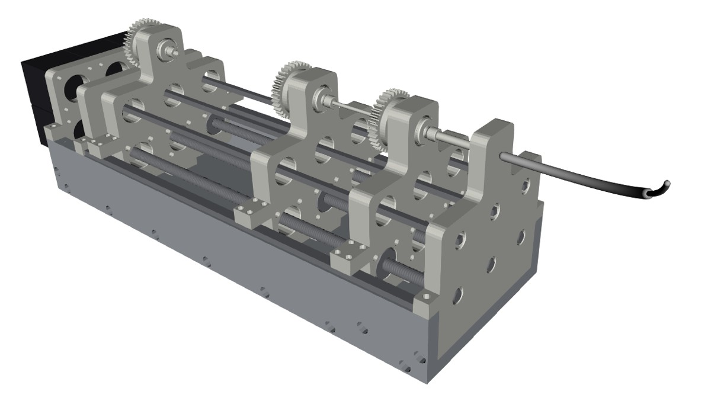

### Concentric Tube Continuum Robot Models - The PyCtr Package

#### Overview
PyCtr is an implementation of a geometrically exact model for concentric tube continuum robots, inspired by the work of [Rucker et al. and John D. Till](https://github.com/JohnDTill/ContinuumRobotExamples). It aims to provide a functional and understandable model for educational and research purposes.

### Installation
To install the package, you can use `poetry`, `rye`, or `pip`. Use the `pyproject.toml` file for managing dependencies and installation.

#### Poetry
1. **Install Poetry (if not already installed):**
   ```bash
   pip install poetry
   ```

2. **Install the package:**
   Navigate to the project directory and run:
   ```bash
   poetry install
   ```
#### Rye
1. **Install Rye (if not already installed):**
   ```bash
   curl -sSf https://rye.astral.sh/get | bash
   ```

2. **Install the package:**
   Navigate to the project directory and run:
   ```bash
   rye add pyctr --git git@github.com:hdonat/pyctr.git
   rye sync
   ```
#### Pip
1. **Install the package**
   ```bash
   pip install <path to pyctr>
   ```

### Using the Models

#### Importing and Configuring the Robot
The package provides models for simulating the configuration and behavior of concentric tube continuum robots.

Example usage:
```python
from pyctr import ConcentricTubeContinuumRobot

# Initialize the robot with specific parameters
robot = ConcentricTubeContinuumRobot(tube_parameters)

# Change the configuration
robot.change_configuration(configuration_parameters)

# Apply external forces
robot.apply_external_forces(forces)
```

#### Visualizing the Robot
The package includes tools for visualizing the robot configurations.

Example usage:
```python
from pyctr import plot_robot

# Plot the current configuration of the robot
plot_robot(robot)
```

#### Changing Configuration and Applying External Forces
This example demonstrates how to change the configuration of the robot and apply external forces.

```python
from pyctr import ConcentricTubeContinuumRobot

# Initialize the robot
robot = ConcentricTubeContinuumRobot(tube_parameters)

# Change the configuration
new_configuration = {'param1': value1, 'param2': value2}
robot.change_configuration(new_configuration)

# Apply external forces
external_forces = {'force1': value1, 'force2': value2}
robot.apply_external_forces(external_forces)

# Verify the changes
print(robot.current_state)
```

### Simulation with Drake
`pyctr.drake_system.ConcentricTubeRobotSystem` runs the dynamic robot model in a [Drake](https://drake.mit.edu) diagram: tube rotation and insertion as inputs, contact with obstacles in the `SceneGraph`, and force exchange with bodies of a `MultibodyPlant`. `pyctr.actuation_unit` optionally adds the IRP actuation unit (STL files from [irp_concentric_tube_continuum_robot](https://github.com/IRP-TU-BS/irp_concentric_tube_continuum_robot)), with carriages that follow the insertion.



```bash
pip install -e ".[drake]"
```

The tutorial `docs/notebooks/Simulation with Drake.ipynb` shows both setups, robot only and robot in the actuation unit, and has a table to choose between them.

### C++ implementation
The directory `cpp/` contains a C++ port of all models with Python bindings (`pyctr_cpp`, same classes and methods, 10 to 700 times faster). The Python package stays the readable reference implementation. See [cpp/README.md](cpp/README.md).

### Future Plans
- Improve documentation
- Make the package available on PyPI

For detailed documentation, refer to the project's documentation generated via `make html` in the `doc` folder.
